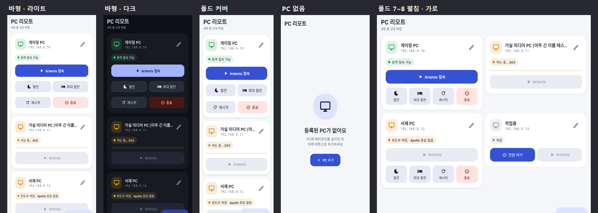
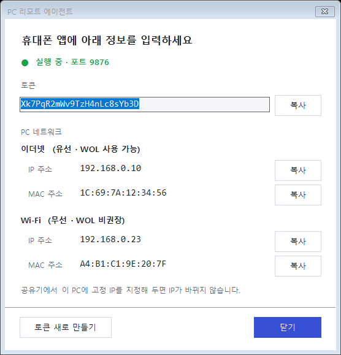
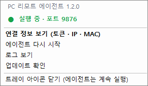
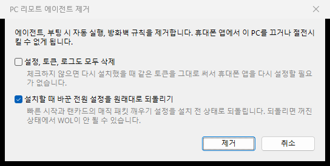

# PC 리모트 (갤럭시용 WOL + 원격 전원 + Artemis)



**다운로드:** 이 저장소의 [Releases](../../releases) 페이지에서 받으세요.
- 휴대폰: `PcRemote.apk`
- PC: `PcRemoteAgent-Setup-x.y.z.exe` (Windows 10/11 64비트)

바형 갤럭시와 폴드 1~8의 커버·메인 화면, 라이트·다크 모드를 지원합니다.

| 기능 | 동작 방식 |
|---|---|
| 켜기 (WOL) | 매직 패킷을 UDP 브로드캐스트로 전송 (집 밖에서는 ipTIME DDNS로 전송) |
| 절전 / 최대 절전 / 재시작 / 종료 | PC에 설치한 에이전트(`pc-agent`)에 서명된 HTTP 요청 (집 밖에서는 DDNS로) |
| 부팅 확인 | 전원 켜기 후 2초마다 확인: 켜는 중 → 윈도우 켜짐 → 원격 접속 가능 (최대 3분) |
| Artemis 접속 | Apollo(포트 47989)가 응답할 때만 버튼 활성화, 자동 실행 안 함 |
| 상태 표시 | 5초마다 에이전트 `/ping`과 Apollo 포트 확인 (초록 = 접속 가능, 노랑 = 켜는 중) |

```
android/    안드로이드 앱 (Kotlin + Jetpack Compose)
pc-agent/   윈도우 PC용 에이전트
  src/        에이전트와 설치·제거·연결 정보 스크립트 (PowerShell)
  installer/  Inno Setup 설치 프로그램 스크립트
```

---

## 1. PC 설정

### 1-1. BIOS에서 WOL 켜기
메인보드 BIOS에 들어가서 아래 항목을 켭니다. 이름은 제조사마다 다릅니다.
- `Wake on LAN`, `Power On By PCI-E`, `Resume by PCI-E Device`
- `ErP Ready` / `Deep Sleep`은 **꺼야** 합니다. 켜져 있으면 PC가 꺼진 뒤 랜카드 전원도 끊깁니다.

> WOL은 **유선 LAN**으로 연결해야 확실하게 동작합니다. 무선랜에서 WOL을 지원하는 경우는 드뭅니다.

### 1-2. 에이전트 설치
`PcRemoteAgent-Setup-x.y.z.exe`를 실행합니다. 관리자 권한 확인 창이 뜨면 "예"를 누르세요.

1. **전원 설정:** "Wake-on-LAN 설정"을 체크해 두면 아래 두 가지를 자동으로 설정합니다. 바꾸기 전 값은 저장해 두었다가 제거할 때 되돌릴 수 있습니다.
   - 윈도우 **빠른 시작 끄기**: 빠른 시작이 켜져 있으면 완전히 꺼진 상태에서 WOL이 안 되는 경우가 많습니다.
   - 유선 랜카드의 **매직 패킷으로만 깨우기**: 패턴 일치 웨이크를 끕니다. 켜져 있으면 일반 네트워크 접속(휴대폰 앱의 상태 확인 등)에도 PC가 절전에서 깨어납니다.
   - 랜카드 **절전 기능 끄기** (Realtek의 Power Saving Mode, 절전형 이더넷): 켜져 있으면 절전 중에 매직 패킷을 못 받는 경우가 많습니다.
   - 랜카드 설정을 바꿀 때 네트워크가 몇 초 끊깁니다.
2. **포트:** 특별한 이유가 없으면 기본값 9876을 그대로 둡니다.
3. 설치가 끝나면 **연결 정보 창**이 열립니다. 토큰, IP, MAC 주소를 휴대폰 앱에 입력하세요. 각 값 옆의 복사 버튼을 쓰면 편합니다.



- **트레이 아이콘:** "로그인할 때 트레이 아이콘 표시"를 체크해 두면(기본값) 작업 표시줄 오른쪽에 아이콘이 생깁니다.
  - 컬러 아이콘은 에이전트가 실행 중, 회색은 멈춤입니다. 멈추면 알림이 뜹니다.
  - **더블클릭**하면 연결 정보 창이 열립니다.
  - **우클릭** 메뉴에서 연결 정보 보기, 에이전트 다시 시작, 로그 보기, 트레이 아이콘 닫기를 할 수 있습니다.
  - 트레이 아이콘을 닫아도 에이전트는 계속 실행됩니다. 다시 띄우려면 시작 메뉴 → PC 리모트 에이전트 → **트레이 아이콘 실행**을 누르세요.

  
- 연결 정보 창은 시작 메뉴 → **PC 리모트 에이전트 → 연결 정보 보기**에서도 열 수 있습니다. 여기서 **토큰 새로 만들기**도 할 수 있습니다.
- PC가 부팅될 때마다 에이전트가 SYSTEM 계정으로 자동 실행됩니다. 로그인하기 전에도 동작합니다.
- 방화벽은 **개인 네트워크**에서만 열립니다. 네트워크가 "공용"으로 설정되어 있으면 "개인"으로 바꿔주세요.
- 프로그램 파일은 `C:\Program Files\PC Remote Agent`에 설치됩니다. 설정과 토큰은 `C:\ProgramData\PcRemoteAgent`에 있으며 관리자와 SYSTEM만 읽을 수 있습니다.

### 1-3. 에이전트 제거
**Windows 설정 → 앱 → 설치된 앱**에서 "PC 리모트 에이전트"를 제거하거나, 시작 메뉴의 **PC 리모트 에이전트 제거**를 실행합니다. 제거할 때 아래 항목을 고를 수 있습니다.



- **설정, 토큰, 로그도 모두 삭제:** 체크하면 남는 파일 없이 지웁니다. 체크하지 않으면 다시 설치했을 때 같은 토큰을 그대로 씁니다.
- **전원 설정을 원래대로 되돌리기:** 설치할 때 바꾼 빠른 시작과 랜카드 설정을 설치 전 상태로 되돌립니다.

어떤 항목을 고르든 에이전트 프로그램, 트레이 아이콘, 자동 실행 작업, 방화벽 규칙, 시작 메뉴 바로 가기는 항상 지워집니다.

### 설치 프로그램 직접 빌드
[Inno Setup 6](https://jrsoftware.org/isinfo.php)을 설치한 뒤 실행합니다. 결과물은 `dist/` 폴더에 생깁니다.
```bash
ISCC.exe pc-agent/installer/PcRemoteAgent.iss
```

### 1-4. 원격 접속용 Apollo
Artemis는 PC에 설치된 [Apollo](https://github.com/ClassicOldSong/Apollo) 또는 Sunshine에 접속합니다. Apollo를 설치한 뒤 Artemis에서 PC를 한 번 페어링해 두세요.

## 2. ipTIME 공유기 설정

1. **고정 IP**: `고급 설정 → 네트워크 관리 → DHCP 서버 설정`에서 PC의 MAC 주소에 IP를 고정합니다.
2. **(집 밖에서 쓰려면) DDNS**: `고급 설정 → 특수기능 → DDNS 설정`에서 `myhome.iptime.org` 같은 주소를 등록합니다.
3. **(집 밖에서 쓰려면) 포트 포워딩**: `고급 설정 → NAT/라우터 관리 → 포트포워드 설정`에서 PC의 고정 IP로 두 개를 추가합니다.

   | 용도 | 프로토콜 | 외부 포트 (예) | 내부 포트 | 앱 입력 칸 |
   |---|---|---|---|---|
   | 켜기 (WOL) | **UDP** | `10009` | `9` | WOL 외부 포트 |
   | 상태 확인 · 절전 · 종료 | **TCP** | `19876` | `9876` | 에이전트 외부 포트 |

   앱의 PC 편집 화면 "집 밖에서 사용"에 DDNS 주소(포트 없이 `myhome.iptime.org`만)와 위 두 외부 포트를 입력합니다.
4. ipTIME 관리 페이지에도 `특수기능 → WOL` 메뉴가 있어서, 공유기 자체 기능으로 PC를 켤 수도 있습니다. 앱이 동작하지 않을 때 이 메뉴로 하드웨어 쪽 문제인지 확인할 수 있습니다.

**집 밖에서는 이렇게 동작합니다.** 앱은 먼저 PC의 내부 IP로 연결해 보고, 닿지 않으면 DDNS 주소로 다시 시도합니다. DDNS로 연결되면 카드에 "외부 연결"이 표시됩니다. 에이전트 외부 포트를 비워 두면 집 밖에서는 켜기만 됩니다.

> 🔒 에이전트를 인터넷에 열어도 토큰은 네트워크로 전달되지 않습니다. 명령마다 토큰으로 만든 서명(HMAC-SHA256)과 시각, 1회용 값을 보내고, PC는 2분이 지난 요청이나 이미 쓴 요청을 거부합니다. 중간에서 요청을 가로채도 토큰을 알아내거나 명령을 다시 보낼 수 없습니다. 그래서 **휴대폰과 PC의 시계가 맞아야** 합니다(둘 다 자동 시간 설정이면 문제없습니다). 다만 통신 내용이 암호화되지는 않으므로 더 안전하게 쓰려면 VPN(Tailscale, ipTIME VPN 서버)을 권장합니다.
>
> 꺼진 PC로는 공유기가 포트포워딩을 전달하지 못하는 경우가 있습니다(PC를 끄고 몇 분 지나면 밖에서 안 켜지는 증상). 이때는 ipTIME 원격 관리 → 특수기능 → WOL로 켜세요.

## 3. 앱 빌드·설치

릴리스 페이지의 `PcRemote.apk`는 **출시용 서명 키**로 서명되어 있습니다. 앞으로 나오는 버전도 같은 키로 서명하므로 기존 앱 위에 덮어 설치하면 됩니다.
- v1.3 이하(개발용 키)에서 v1.3.1 이상으로 넘어갈 때만 **한 번** 앱을 지우고 새로 설치해야 합니다. 지우면 등록한 PC가 사라지니, PC의 "연결 정보 보기"를 보며 다시 추가하세요.
- 아래 방법 A·B로 직접 빌드한 디버그 APK는 서명 키가 달라서 릴리스 APK 위에 덮어 설치할 수 없습니다.

### 출시용 APK 빌드 (서명 키 보관자)
서명 키는 저장소 밖 `%USERPROFILE%\.pcremote\`에 있습니다(`pcremote-release.jks`, `keystore.properties`). 이 폴더가 있으면 아래 명령이 서명된 APK를 만듭니다.
```bash
gradle assembleRelease
```
결과물: `android/app/build/outputs/apk/release/app-release.apk`

> ⚠️ **`.pcremote` 폴더 전체를 USB나 개인 클라우드에 백업하세요.** 이 키를 잃으면 이후 버전을 기존 앱 위에 설치할 수 없습니다. 이 폴더는 절대 GitHub에 올리지 마세요(`.gitignore`로 막아 두었습니다). 다른 위치의 키를 쓰려면 환경 변수 `PCREMOTE_KEYSTORE_PROPERTIES`에 `keystore.properties` 경로를 지정합니다.

### 방법 A: Android Studio
1. Android Studio에서 `android` 폴더를 엽니다. Gradle 동기화는 자동으로 진행됩니다.
2. 갤럭시에서 `설정 → 휴대전화 정보 → 소프트웨어 정보 → 빌드번호`를 7번 눌러 개발자 모드를 켭니다.
3. `개발자 옵션 → USB 디버깅`을 켜고 USB로 연결한 뒤 ▶ Run을 누릅니다.

### 화면 스냅샷 (에뮬레이터 불필요)
`android` 폴더에서 `gradle recordPaparazziDebug`를 실행하면 바형·폴드 커버·폴드 메인 화면 크기별 스크린샷이 `app/src/test/snapshots/images/`에 생성됩니다.

### 방법 B: GitHub Actions (PC에 개발 도구 설치 불필요)
이 폴더를 GitHub 저장소에 push하면 `.github/workflows/build-apk.yml`이 APK를 빌드합니다. 빌드가 끝나면 Actions 탭 → Artifacts에서 `app-debug.apk`를 받아 휴대폰에 설치합니다. 설치할 때 "출처를 알 수 없는 앱" 허용이 필요합니다.

### Artemis
[Artemis 릴리스 페이지](https://github.com/ClassicOldSong/moonlight-android/releases)에서 APK를 설치합니다. 앱은 Artemis(`com.limelight.noir`)를 먼저 찾고, 없으면 Moonlight를 실행합니다.

## 4. 앱 사용법
1. **+** 버튼으로 PC를 추가합니다. 이름, IP, MAC, 토큰을 입력합니다.
2. **전원 켜기**: WOL을 보내고 부팅 상태를 보여줍니다. 완전히 켜지면 "원격 접속할 수 있습니다" 알림이 뜹니다.
3. **Artemis 접속**: PC가 원격 접속 가능 상태일 때만 활성화됩니다. 직접 눌러야 실행됩니다.
4. **절전 / 최대 절전 / 재시작 / 종료**: 윈도우가 켜져 있을 때만 활성화되고, 확인 창을 거친 뒤 실행됩니다.
5. **상세 화면**: 카드를 누르면 연결 정보(IP, MAC, DDNS, 포트, 현재 연결 경로)와 최근 활동(켜기·끄기 기록, 켜지는 데 걸린 시간, 루틴·빅스비 실행 기록)이 나옵니다.
   - 폴드를 펼치면 왼쪽에 PC 목록, 오른쪽에 상세 화면이 나란히 표시됩니다. PC가 1대면 상세 화면이 전체 폭을 씁니다.
   - 상세 화면을 보던 중 접거나 펼쳐도 같은 PC가 계속 표시됩니다.

## 5. 빅스비 · 모드 및 루틴 연동
앱을 열지 않고 PC를 켜고 끌 수 있습니다. 앱 오른쪽 위 **⚙ 버튼 → 빅스비 · 루틴 연동**에서 필요한 동작을 켜세요.

| 동작 | 앱 목록 이름 |
|---|---|
| WOL로 켜기 | PC 켜기 |
| 절전 / 최대 절전 | PC 절전 / PC 최대 절전 |
| 재시작 / 종료 | PC 재시작 / PC 끄기 |

켠 동작은 **앱 목록에 별도 아이콘**으로 나타납니다. 열면 화면 없이 바로 실행되고, 결과는 화면 아래 짧은 알림(토스트)으로 표시됩니다. 실행 전에 확인 창은 뜨지 않습니다.

- **모드 및 루틴:** 설정 → 모드 및 루틴 → 루틴 → +
  - 예) 조건 "시간: 밤 1시" → 실행할 동작 "앱 → 앱 열기 → PC 끄기"
  - 예) 조건 "Wi-Fi: 집 Wi-Fi에 연결됨" → 실행할 동작 "앱 열기 → PC 켜기"
- **빅스비:** "하이 빅스비, **PC 끄기** 열어줘" / "하이 빅스비, **PC 켜기** 열어줘"
  - One UI 7 이상에서는 루틴의 "빅스비에게 물어보기" 동작에 같은 문장을 넣어서도 쓸 수 있습니다.
- **앱 아이콘 길게 누르기:** PC 켜기·절전·재시작·끄기 바로가기가 나옵니다. 끌어서 홈 화면에 놓을 수도 있습니다.

PC가 여러 대면 PC 편집 화면의 **"빅스비·루틴·바로가기가 이 PC를 제어"**를 체크한 PC가 대상이 됩니다. 앱 화면에서 이름 옆에 "기본" 표시가 붙은 PC입니다.

> 앱 목록 아이콘은 다른 앱도 실행할 수 있습니다. 쓰지 않는 동작은 꺼 두세요.

## 문제 해결
| 증상 | 확인할 것 |
|---|---|
| WOL로 안 켜짐 | BIOS의 WOL 설정·ErP 끄기, 빠른 시작 끄기, 유선 연결 여부, ipTIME WOL 메뉴로 테스트 |
| 절전 후에는 켜지는데 완전히 끈 뒤에는 안 켜짐 | 빠른 시작·ErP 설정 확인, 장치 관리자 → 랜카드 → 고급의 "Shutdown Wake-On-Lan" 항목 |
| 절전시키면 바로 다시 켜짐 | 랜카드 "패턴 일치 웨이크 온" 끄기 (설치 프로그램의 Wake-on-LAN 설정이 자동으로 끔). 앱은 절전·종료 명령 뒤 90초 동안 상태 확인을 멈춥니다 |
| 상태가 계속 "꺼짐" | 공용 네트워크로 설정됐는지, `C:\ProgramData\PcRemoteAgent\agent.log` 내용, 휴대폰이 같은 Wi-Fi에 연결됐는지 |
| "토큰이 올바르지 않습니다" | 시작 메뉴 → PC 리모트 에이전트 → 연결 정보 보기에서 토큰 확인 |
| 설치 중 오류 | `C:\ProgramData\PcRemoteAgent\setup.log` (관리자 권한으로 열기) |
